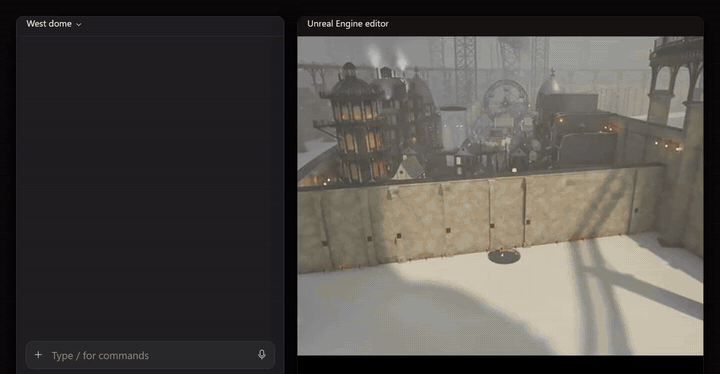
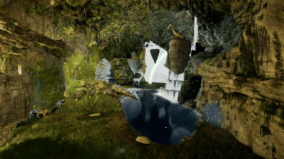
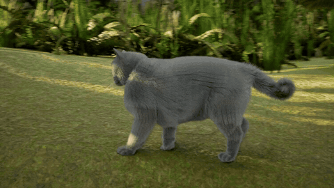

<h1 align="center">GraphCode</h1>

<b>Tell your AI what to build in Unreal Engine. It builds it, in your editor.</b>

<a href="https://graphcode.dev"><b>Website</b></a> ·
<a href="https://github.com/xiangjie9999/GraphCode"><b>Plugins and docs</b></a> ·
<a href="https://graphcode.dev/marketplace">Market</a> ·
<a href="https://graphcode.dev/pricing">Pricing</a>

Asked in plain words on the left; built in Unreal on the right (7× speed).

GraphCode is a set of Unreal Engine plugins that let the AI you already use build your game: gameplay,
menus, levels, terrain, props, characters, animation, hair, clothing and effects. You describe what you
want; the AI makes it as ordinary Unreal assets in your project, renders and plays it to check its work,
and every change it makes is saved so you can compare it or take it back.

| | |
|---|---|
| **Runs on** | Unreal Engine 5.7, Windows 64-bit |
| **Works with** | Claude Code, Codex, Cursor, Claude Desktop or any MCP client |
| **Try it** | 14-day free trial at [graphcode.dev](https://graphcode.dev) |

## Made with GraphCode

<table>
<tr>
<td width="33%" align="center"> Levels and terrain</td>
<td width="33%" align="center"> Animation</td>
<td width="33%" align="center"> Hair and fur</td>
</tr>
</table>

## Where things live

- **Plugins, setup guide and docs:** [xiangjie9999/GraphCode](https://github.com/xiangjie9999/GraphCode)
- **Free packs, pricing and the trial:** [graphcode.dev](https://graphcode.dev)

---

I'm Zhong Han, and I'm building GraphCode. [LinkedIn](https://www.linkedin.com/in/zhonghan98)
